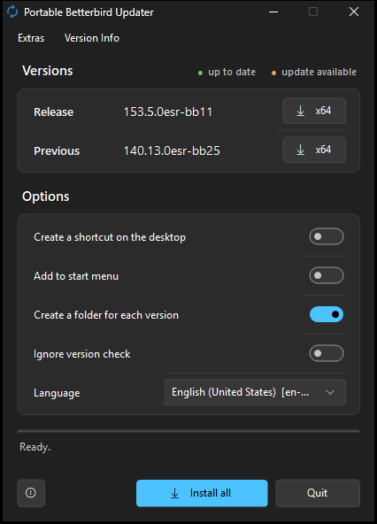

# Portable Betterbird Updater

**English** | [Deutsch](README.de.md)

A small Windows program that downloads **[Betterbird](https://www.betterbird.eu)** – the fine-tuned version of Thunderbird – in its two current versions **Release and Previous** and sets it up as a **portable version**: program files in `App\`, mail, accounts, settings and add-ons in `Profile\`. No installer, no service, nothing written to `%APPDATA%` or the registry.



## Download

**[Latest release](https://github.com/naderi/portable-betterbird-updater/releases/latest)** – download `BetterbirdUpdater.exe`, put it into an empty folder where Betterbird should go (e.g. `D:\Apps\Betterbird`) and run it. No installation needed.

**Requirements:** Windows 11 (x64) with .NET Framework 4.5 or later (preinstalled).

## How it works

1. Betterbird offers two versions, both based on Thunderbird ESR: **Release** (the current major version, e.g. 153) and **Previous** (the one before, e.g. 140). The updater asks `https://www.betterbird.eu/downloads/get.php` for the current setup of each; the version is part of its file name.
2. The official setup `betterbird-<version>.<language>.win64.installer.exe` is downloaded from betterbird.eu (about 90 MB). Betterbird is built separately for every language, so the **Language** selection decides which one is downloaded.
3. The download is verified by **SHA-256** against Betterbird's checksum file `sha256-<major version>.txt`.
4. The setup is a 7z self-extractor. It is **not run** but extracted with the `tar.exe` that comes with Windows; its `core\` folder (`betterbird.exe`, `xul.dll` …) becomes `App\`.
5. The uninstaller is removed from `App\`, and `App\distribution\policies.json` switches the built-in update check off (see below).

> Betterbird is built for **x64 only**, so there are no x86 versions. Languages with a Windows setup: German, English (US), Spanish, French, Italian, Japanese, Dutch, Portuguese (Brazil) and Russian.
>
> **Requirement:** Windows 11. The `tar.exe` of Windows 10 cannot read LZMA-compressed 7z archives; the updater then reports *"Unpacking failed (tar.exe needs 7z support, Windows 11)"*.

## Using it

| Element | What it does |
|---|---|
| **x64** per version | Installs or updates this version. **Green** with a check mark = up to date, **orange** = update available (or installed in another language), neutral with a download arrow = not installed. The tooltip shows the folder, the installed version and its language. |
| **Install all / Update all** | Installs or updates Release and Previous. Versions that are up to date are skipped. |
| **Create a shortcut on the desktop** | Creates a desktop shortcut after installing (pointing to `BetterbirdPortable.exe`). |
| **Add to start menu** | Creates a start menu entry after every installation or update – in the start menu folder **"Betterbird Portable"** (with *Create a folder for each version*) or as the entry "Betterbird Portable". Single entries can be removed again via *Extras → Add to start menu*. |
| **Create a folder for each version** | On: every version gets its own folder (`Betterbird Release x64`, `Betterbird Previous x64`). Off: installs directly into the updater's folder; *Install all* is disabled then. |
| **Ignore version check** | Downloads and installs again even if the version is already up to date. |
| **Language** | Language of the downloaded Betterbird (default: matching your Windows language). Used from the next installation on; versions installed in another language are marked orange and downloaded again with *Update all*. The profile is kept. |
| **Quit** | Closes the program. During a download it becomes **Cancel**. |
| **ⓘ** (bottom left) | About window with version, developer, website and program updates. |

**Extras menu**

- *Check versions again* (F5)
- *Open install folder*
- *Create shortcuts on the desktop now* – for all installed versions
- *Add to start menu* – with **Create a folder for each version** a submenu: *All installed versions*, every installed version on its own (check mark = in the start menu, a click adds or removes it) and *Remove all from start menu*. Without that option it is a single item that adds or removes the entry "Betterbird Portable".
- *Portable profile for each version* (`.\Profile`) / *One portable profile for all versions* (`..\Profile`) – applied to all installed versions right away
- *Keep downloaded installers* / *Delete downloaded installers* – the setups are kept in `Update\`; an existing setup with the right checksum is reused

**Version Info menu:** links to the Betterbird release notes, the download page and the about window.

If a Betterbird from the target folder is still running, the updater asks you to close it instead of overwriting files in use. The program appears in German when Windows is set to German, otherwise in English. It follows the light or dark Windows theme and the accent color.

## Folder structure

With **Create a folder for each version**:

```
<updater folder>\
├─ BetterbirdUpdater.exe
├─ BetterbirdUpdater.ini            settings of the updater
├─ Profile\                         only with "one profile for all versions"
├─ Betterbird Release x64\
│  ├─ BetterbirdPortable.exe        ← start Betterbird with this
│  ├─ BetterbirdPortable.ini        settings of the launcher
│  ├─ Profile\                      portable profile: mail, accounts, settings, add-ons
│  └─ App\                          program files
│     ├─ betterbird.exe …
│     └─ updates\Version.log
└─ Betterbird Previous x64\
```

Without that option, `BetterbirdPortable.exe`, `BetterbirdPortable.ini`, `App\` and `Profile\` are placed directly in the updater's folder. An update only replaces `App\`; `Profile\` is never touched.

## The launcher `BetterbirdPortable.exe`

- starts `App\betterbird.exe` with `-profile "<portable profile>"`, so neither `%APPDATA%\Thunderbird` nor `profiles.ini` is used,
- appends the switches from `BetterbirdPortable.ini` and its own command line arguments (e.g. `mailto:` links),
- carries the Betterbird icon.

> **No auto-update:** the updater adds `App\distribution\policies.json` (`DisableAppUpdate`), so Betterbird does not look for updates itself. The policy also sets `mail.shell.checkDefaultClient` to `false`, so Betterbird does not ask on every start whether it should become the default mail program (can be changed in the settings). Updates come only through this updater.

### BetterbirdPortable.ini

Next to every `BetterbirdPortable.exe`. Lines starting with `;` or `#` are comments.

```ini
ProfileDir=Profile
Flags=-offline
```

**`ProfileDir`** – folder of the profile, relative to the launcher's folder or absolute. `Profile` = own profile for this version (default), `..\Profile` = one profile in the updater's folder for all versions.

> The updater rewrites `ProfileDir` on every installation and when you switch it in the *Extras* menu, so better change the profile there. Only the `Flags=` line is kept on updates. A **shared profile** cannot be used by two versions at the same time, and a profile used by Release opens in Previous only with `-allow-downgrade` – at the risk of losing data.

**`Flags`** – additional command line switches, all **on one line**, separated by spaces:

| Switch | Effect |
|---|---|
| `-offline` | starts in offline mode |
| `-safe-mode` | troubleshoot mode (add-ons disabled) |
| `-purgecaches` | clears the startup caches (e.g. after problems with add-ons) |
| `-allow-downgrade` | allows opening a profile of a newer version |
| `-mail` / `-addressbook` / `-compose` | opens the mail window, the address book or a new message |

Arguments passed to `BetterbirdPortable.exe` are forwarded too, e.g. `BetterbirdPortable.exe mailto:info@example.com`.

## Updates of the updater

The updater updates itself from the [releases of this repository](https://github.com/naderi/portable-betterbird-updater/releases):

- Once a day it looks for a new version in the background (can be switched off in the about window: *Check automatically (once a day)*). If there is one, the ⓘ button gets an orange dot.
- In the about window: *Check for updates* → *Download update* → *Restart & update*.
- A download is only used if its signature (`.sig`) matches the key built into the program; anything else is rejected. The running EXE is renamed to `.old`, the new one takes its name, and the program restarts. `BetterbirdUpdater.ini` and all data next to it stay untouched.

## Disclaimer

This is an independent project. It is not affiliated with, endorsed or sponsored by the Betterbird project, MZLA Technologies or Mozilla. Thunderbird is a trademark of the Mozilla Foundation. The programs downloaded by this updater are subject to their own license terms.

## License

Freeware – free to use, but **not for sale**. See [LICENSE](LICENSE).

## Support

If Portable Betterbird Updater saves you time, you can support its development on Ko‑fi. ☕

<a href='https://ko-fi.com/N7N123QIX0' target='_blank'></a>

---

© 2026 [Ali Naderi](https://github.com/naderi) · [digitalent.dev](https://digitalent.dev/en/)
